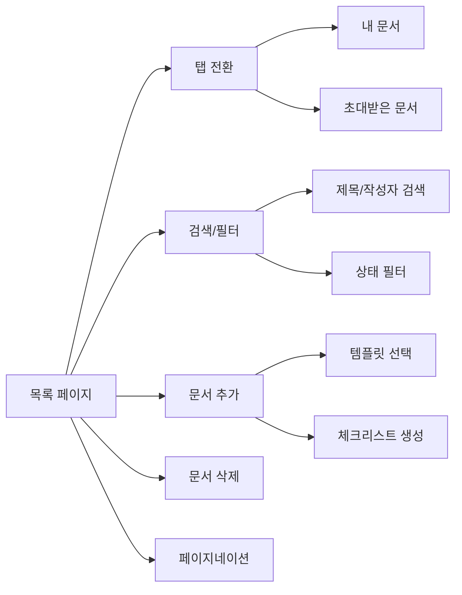
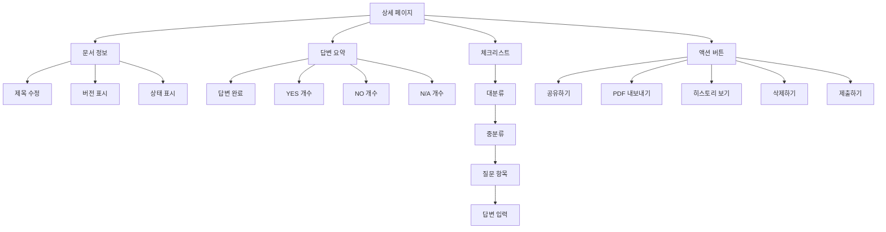
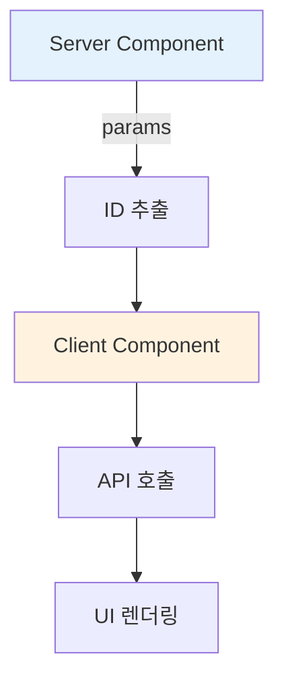
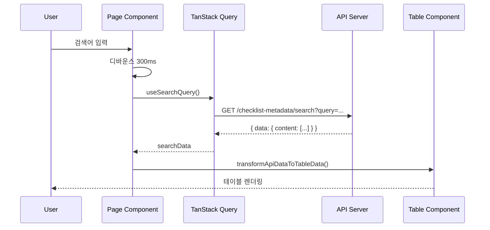
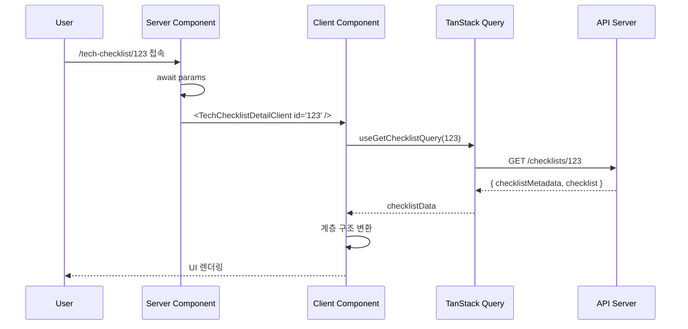
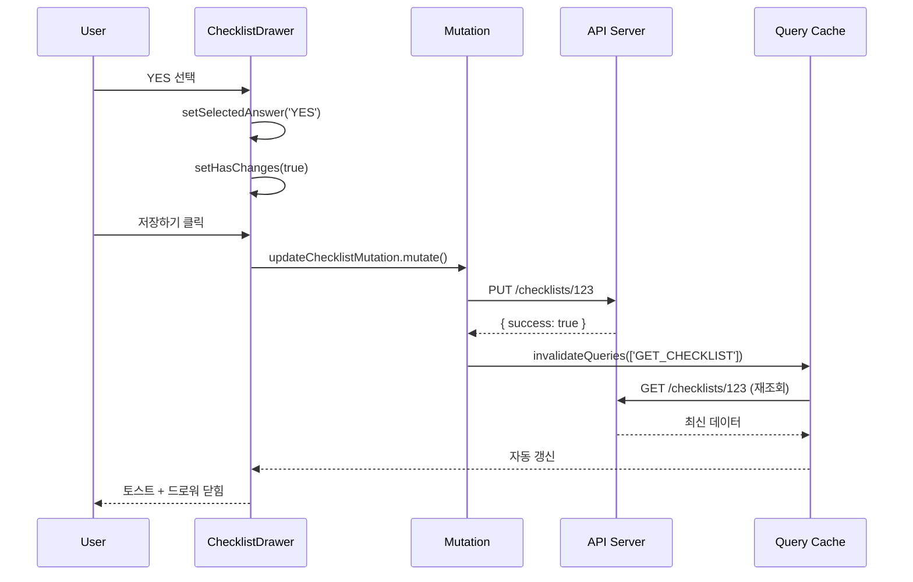

# 📋 기술 체크리스트 (Tech Checklist) 구현 문서

> **작성일**: 2025-01-24
> **대상**: `/src/app/(main)/tech-checklist` 디렉토리
> **목적**: 기술 체크리스트 페이지의 구현 현황, 아키텍처, API 연동 상태를 한눈에 파악

---

## 📑 목차

1. [개요](#1-개요)
2. [디렉토리 구조](#2-디렉토리-구조)
3. [주요 기능](#3-주요-기능)
4. [페이지 라우팅](#4-페이지-라우팅)
5. [핵심 컴포넌트](#5-핵심-컴포넌트)
6. [API 연동](#6-api-연동)
7. [데이터 흐름](#7-데이터-흐름)
8. [상태 관리](#8-상태-관리)
9. [디자인 토큰 사용 현황](#9-디자인-토큰-사용-현황)
10. [개선 사항 및 TODO](#10-개선-사항-및-todo)
11. [참고 문서](#11-참고-문서)

---

## 1. 개요

### 📌 기술 체크리스트란?

기술 체크리스트는 **안전 규격 준수 여부를 체계적으로 검증**하기 위한 문서 관리 시스템입니다.

### 🎯 주요 목적

- ✅ 질문지 템플릿 기반 체크리스트 생성
- ✅ YES/NO/N/A 답변 입력 및 증빙 파일 첨부
- ✅ 답변 현황 요약 및 진행률 추적
- ✅ 버전 관리 (revision) 및 제출 이력 관리
- ✅ PDF 내보내기 및 문서 공유

### 🔑 핵심 특징

- **계층 구조**: 대분류 → 중분류 → 질문 항목 (3단계)
- **템플릿 기반**: 사전 정의된 질문지를 선택하여 생성
- **상태 관리**: `작성 중` ↔ `제출 완료` 상태 전환
- **버전 관리**: 제출 시마다 `rev` 번호 증가

---

## 2. 디렉토리 구조

```
src/app/(main)/tech-checklist/
│
├── page.tsx                          # 📄 체크리스트 목록 페이지
├── _source/                          # 📂 목록 페이지 전용 코드
│   ├── components/
│   │   ├── add-document-dialog.tsx   # 💬 질문지 선택 및 문서 추가 모달
│   │   ├── document-filter-bar.tsx   # 🔍 검색/필터/삭제 액션 바
│   │   ├── document-pagination.tsx   # 📑 페이지네이션
│   │   ├── document-tabs.tsx         # 🗂️ "내 문서" / "초대받은 문서" 탭
│   │   ├── tech-checklist-table.tsx  # 📊 체크리스트 목록 테이블
│   │   └── index.ts
│   └── hooks/
│       └── useDocumentFilter.ts      # 🎣 필터링 로직 (현재 미사용)
│
├── [id]/                             # 📂 동적 라우팅 (상세 페이지)
│   ├── page.tsx                      # 📄 체크리스트 상세 페이지 (Server Component)
│   ├── _source/
│   │   └── components/
│   │       ├── tech-checklist-detail-client.tsx  # 🖥️ 상세 페이지 Client Component
│   │       ├── checklist-table.tsx               # 📋 계층 구조 아코디언 테이블
│   │       ├── checklist-drawer.tsx              # 📝 질문 답변 입력 드로워
│   │       ├── answer-summary-cards.tsx          # 📊 YES/NO/N/A 요약 카드
│   │       ├── share-dialog.tsx                  # 🔗 문서 공유 모달
│   │       ├── delete-dialog.tsx                 # 🗑️ 삭제 확인 모달
│   │       ├── pdf-export-dialog.tsx             # 📄 PDF 내보내기 모달
│   │       ├── scroll-gradient-wrapper.tsx       # 🎨 스크롤 그라데이션 효과
│   │       └── index.ts
│   │
│   └── history/                      # 📂 히스토리 페이지
│       ├── page.tsx                  # 📄 제출 이력 목록
│       ├── _source/
│       │   └── components/
│       │       ├── restore-dialog.tsx       # ⏪ 히스토리 복원 모달
│       │       └── index.ts
│       └── [historyId]/
│           └── page.tsx              # 📄 특정 버전 상세 페이지
```

### 📁 디렉토리 설명

| 경로 | 역할 | 주요 특징 |
|------|------|-----------|
| `tech-checklist/page.tsx` | 목록 페이지 | Client Component, API 연동 |
| `tech-checklist/_source/` | 목록 페이지 전용 코드 | `_`로 시작하여 라우팅에서 제외 |
| `[id]/page.tsx` | 상세 페이지 | Server Component (params await) |
| `[id]/_source/` | 상세 페이지 전용 코드 | Client Component들 포함 |
| `history/` | 제출 이력 관리 | Mock 데이터 사용 (API 미구현) |

---

## 3. 주요 기능

### 3.1 목록 페이지 (`/tech-checklist`)



#### ✅ 구현된 기능

- [x] 체크리스트 목록 조회 (API 연동 완료)
- [x] 검색 기능 (디바운스 300ms)
- [x] 상태 필터 (`작성 중`, `제출 완료`)
- [x] 문서 추가 (템플릿 선택)
- [x] 다중 선택 삭제
- [x] 페이지네이션 (10개/페이지)
- [x] 행 클릭 → 상세 페이지 이동

#### ❌ 미구현 기능

- [ ] "초대받은 문서" 탭 (백엔드 API 대기)
- [ ] 정렬 기능 (현재 최신순 고정)

---

### 3.2 상세 페이지 (`/tech-checklist/[id]`)



#### ✅ 구현된 기능

- [x] 체크리스트 상세 조회 (API 연동 완료)
- [x] 제목 수정 (API 연동 완료)
- [x] 계층 구조 아코디언 (대분류/중분류/질문)
- [x] 답변 입력 드로워 (YES/NO/N/A)
- [x] 답변 저장 (API 연동 완료)
- [x] 답변 요약 카드 (실시간 계산)
- [x] 제출하기 (버전 생성 API 연동)
- [x] 공유 모달 (UI만 구현)
- [x] PDF 내보내기 (UI만 구현)
- [x] 삭제 모달 (UI만 구현)

#### ❌ 미구현 기능

- [ ] 증빙 파일 업로드 (UI만 존재, API 연동 필요)
- [ ] 비고 입력 저장 (읽기 전용)
- [ ] 공유 기능 백엔드 연동
- [ ] PDF 실제 생성 및 다운로드
- [ ] 삭제 기능 API 연동

---

### 3.3 히스토리 페이지 (`/tech-checklist/[id]/history`)

#### ⚠️ 주의: Mock 데이터 사용 중

현재 히스토리 페이지는 **Mock 데이터**를 사용하며, 백엔드 API가 준비되면 연동 필요합니다.

```typescript
// history/page.tsx
const MOCK_HISTORY_DATA = [
  { id: '1', version: 'rev9', submitter: { ... }, submittedAt: { ... } },
  // ...
]
```

#### ✅ 구현된 기능

- [x] 제출 이력 목록 (Mock)
- [x] 버전별 상세 페이지
- [x] 복원 모달 (UI만)
- [x] 페이지네이션

#### ❌ 미구현 기능

- [ ] 실제 API 연동
- [ ] 히스토리 복원 기능

---

## 4. 페이지 라우팅

### 4.1 라우팅 구조

| URL 패턴 | 파일 경로 | 설명 |
|----------|-----------|------|
| `/tech-checklist` | `page.tsx` | 목록 페이지 |
| `/tech-checklist/123` | `[id]/page.tsx` | 상세 페이지 (ID=123) |
| `/tech-checklist/123/history` | `[id]/history/page.tsx` | 제출 이력 목록 |
| `/tech-checklist/123/history/1` | `[id]/history/[historyId]/page.tsx` | 특정 버전 상세 |

### 4.2 Server Component vs Client Component



#### Server Component 패턴

```tsx
// app/tech-checklist/[id]/page.tsx
export default async function TechChecklistDetailPage({ params }: PageProps) {
  const { id } = await params  // ✅ Next.js 15+ 비동기 params
  return <TechChecklistDetailClient id={id} />
}
```

#### Client Component 패턴

```tsx
// _source/components/tech-checklist-detail-client.tsx
'use client'

export function TechChecklistDetailClient({ id }: { id: string }) {
  const { data } = useGetChecklistQuery({ checklistId: Number(id) })
  // ...
}
```

---

## 5. 핵심 컴포넌트

### 5.1 목록 페이지 컴포넌트

#### 📄 `page.tsx` - 목록 페이지 루트

```tsx
'use client'

export default function TechChecklistPage() {
  const [activeTab, setActiveTab] = useState('my-docs')
  const [searchQuery, setSearchQuery] = useState('')
  const [selectedFilters, setSelectedFilters] = useState<string[]>([])

  // ✅ API 호출: 체크리스트 검색
  const { data: searchData } = useSearchQuery({
    variables: {
      query: {
        'requestDto.query': searchQuery,
        'requestDto.statusList': mapFilterToStatusList(selectedFilters),
        'pageable.page': currentPage - 1,
        'pageable.size': 10,
        'pageable.sort': ['checklistMetadataId,desc'],
      }
    }
  })

  // ...
}
```

**주요 특징**:
- ✅ Client Component (`'use client'`)
- ✅ TanStack Query로 API 호출
- ✅ 검색/필터/페이지네이션 상태 관리
- ✅ 삭제 Mutation (병렬 실행)

---

#### 🗂️ `TechChecklistTable` - 목록 테이블

**파일**: `_source/components/tech-checklist-table.tsx`

```tsx
const transformApiDataToTableData = (apiData) => {
  return apiData.map((item) => ({
    id: String(item.checklistMetadata.checklistMetadataId),
    title: item.checklistMetadata.title,
    version: { text: `rev${item.checklistMetadata.currentRevisionNumber}` },
    status: {
      text: item.checklistMetadata.status === 'SUBMITTED' ? '제출 완료' : '작성 중'
    },
    // ...
  }))
}
```

**주요 특징**:
- ✅ API 응답 → 테이블 데이터 변환
- ✅ 로딩/빈 상태 처리
- ✅ 체크박스 선택 지원
- ❌ YES/NO/N/A 개수는 API 미제공 (임시값 `-`)

---

#### 💬 `AddDocumentDialog` - 문서 추가 모달

**파일**: `_source/components/add-document-dialog.tsx`

```tsx
const { data: templatesData } = useGetChecklistTemplateListQuery()

const createChecklistMutation = useCreateChecklistMutation({
  onSuccess: () => {
    queryClient.invalidateQueries({ queryKey: ['SEARCH'] })
    toast.success('새로운 기술 체크리스트가 추가됐어요.')
  }
})

const handleConfirm = () => {
  createChecklistMutation.mutate({
    data: { checklistTemplateId: Number(selectedQuestionnaire) }
  })
}
```

**주요 특징**:
- ✅ 템플릿 목록 API 조회
- ✅ 라디오 버튼으로 선택
- ✅ 생성 성공 시 목록 자동 갱신
- ✅ 로딩/빈 상태 처리

---

### 5.2 상세 페이지 컴포넌트

#### 🖥️ `TechChecklistDetailClient` - 상세 페이지 루트

**파일**: `[id]/_source/components/tech-checklist-detail-client.tsx`

```tsx
'use client'

export function TechChecklistDetailClient({ id }: { id: string }) {
  // ✅ API 호출: 체크리스트 조회
  const { data: checklistData } = useGetChecklistQuery({
    variables: { checklistId: Number(id) }
  })

  // ✅ 제목 수정 Mutation
  const updateTitleMutation = useUpdateMutation({
    onSuccess: () => {
      queryClient.invalidateQueries({ queryKey: ['SEARCH'] })
      queryClient.invalidateQueries({ queryKey: ['GET_CHECKLIST'] })
    }
  })

  // ✅ 제출하기 Mutation (버전 생성)
  const createRevisionMutation = useCreateRevisionMutation({
    onSuccess: () => {
      toast.success('문서가 제출됐어요.')
    }
  })

  // 계층 구조 변환
  const checklistGroups = useMemo(() => {
    return checklistData.checklist.checklistMajorCategoryList.map((major) => ({
      id: major.checklistCategoryId,
      title: major.name,
      children: major.checklistMediumCategoryList.map((medium) => ({
        id: medium.checklistCategoryId,
        title: medium.name,
        items: medium.checklistItemList.map((item) => ({
          id: item.checklistItemId,
          question: item.question,
          answer: item.answer,
          // ...
        }))
      }))
    }))
  }, [checklistData])

  // ...
}
```

**주요 특징**:
- ✅ API 데이터를 계층 구조로 변환
- ✅ 제목 수정/제출하기 Mutation
- ✅ 로딩/에러/빈 상태 처리
- ✅ PDF 데이터 변환 로직

---

#### 📋 `ChecklistTable` - 계층 구조 아코디언

**파일**: `[id]/_source/components/checklist-table.tsx`

```tsx
export function ChecklistTable({ groups, onItemClick }: ChecklistTableProps) {
  return (
    <AccordionRoot multiple collapsible>
      {groups.map((group) => (
        <ChecklistGroupSection group={group} onItemClick={onItemClick} />
      ))}
    </AccordionRoot>
  )
}
```

**계층 구조**:
```
대분류 (ChecklistGroupSection)
  ├─ 중분류 (ChecklistSubGroupSection)
  │   ├─ 질문 항목 (ChecklistItemRow)
  │   ├─ 질문 항목
  │   └─ ...
  └─ ...
```

**주요 특징**:
- ✅ 3단계 아코디언 구조
- ✅ 행 클릭 시 드로워 열림
- ✅ 답변 상태별 색상 구분
- ❌ 색상 하드코딩 (디자인 토큰 미사용)

```tsx
// ⚠️ 개선 필요: 하드코딩된 색상
const ANSWER_COLORS: Record<AnswerType, { bg: string; text: string }> = {
  YES: { bg: '#f0f6f2', text: '#1f8441' },
  NO: { bg: '#fef0f0', text: '#d71515' },
  'N/A': { bg: '#f5f3fc', text: '#8270db' },
  '답변 없음': { bg: '#f2f4f5', text: '#848d98' },
}
```

---

#### 📝 `ChecklistDrawer` - 답변 입력 드로워

**파일**: `[id]/_source/components/checklist-drawer.tsx`

```tsx
export function ChecklistDrawer({ open, onOpenChange, checklistId, item }) {
  const [selectedAnswer, setSelectedAnswer] = useState<ChecklistAnswer>()
  const [hasChanges, setHasChanges] = useState(false)

  // ✅ 답변 저장 Mutation
  const updateChecklistMutation = useUpdateChecklistMutation({
    onSuccess: () => {
      queryClient.invalidateQueries({ queryKey: ['GET_CHECKLIST'] })
      toast.success('답변이 저장됐어요.')
      onOpenChange(false)
    }
  })

  const handleSave = () => {
    updateChecklistMutation.mutate({
      checklistId,
      data: {
        checklistItemAnswerList: [{
          checklistItemId: Number(item.id),
          answer: selectedAnswer === 'N/A' ? 'NA' : selectedAnswer,
          supportFileIdList: [],  // ❌ TODO: 파일 업로드 구현
        }]
      }
    })
  }

  // ...
}
```

**주요 특징**:
- ✅ YES/NO/N/A 선택 (ChecklistSelect)
- ✅ 이탈 방지 경고 (변경사항 있을 때)
- ✅ 답변 저장 API 연동
- ❌ 파일 업로드 미구현 (UI만 존재)
- ❌ 비고 입력 읽기 전용

---

#### 📊 `AnswerSummaryCards` - 답변 요약 카드

**파일**: `[id]/_source/components/answer-summary-cards.tsx`

```tsx
export function AnswerSummaryCards({ data }: { data: AnswerSummary }) {
  const answered = data.yes + data.no + data.na

  return (
    <HStack gap="2">
      {/* 답변 완료 카드 (파란색) */}
      <Box bg="primary.600" borderRadius="xl" p="3">
        <Text fontSize="5xl" fontWeight="bold" color="white">
          {answered}
        </Text>
      </Box>

      {/* YES 카드 (초록색) */}
      <Box bg="white" border="1px solid" borderColor="grey.100">
        <Box w="7px" h="7px" bg="#22a04c" />  {/* ⚠️ 하드코딩 */}
        <Text fontSize="5xl">{data.yes}</Text>
      </Box>

      {/* NO 카드 (빨간색) */}
      {/* N/A 카드 (보라색) */}
    </HStack>
  )
}
```

**주요 특징**:
- ✅ 실시간 답변 개수 집계
- ✅ 반응형 레이아웃 (Desktop: 가로 / Mobile: 세로)
- ⚠️ 색상 하드코딩 (`#22a04c`, `#ee3538` 등)

---

## 6. API 연동

### 6.1 사용 중인 API 엔드포인트

| API | 메서드 | 엔드포인트 | 용도 | 상태 |
|-----|--------|-----------|------|------|
| **템플릿 목록** | GET | `/v1/checklist-templates` | 질문지 템플릿 조회 | ✅ 연동 완료 |
| **체크리스트 생성** | POST | `/v1/checklists` | 새 체크리스트 생성 | ✅ 연동 완료 |
| **체크리스트 검색** | GET | `/v1/checklist-metadata/search` | 목록 조회 (검색/필터) | ✅ 연동 완료 |
| **체크리스트 조회** | GET | `/v1/checklists/{id}` | 상세 정보 조회 | ✅ 연동 완료 |
| **제목 수정** | PUT | `/v1/checklist-metadata/{id}` | 문서 제목 변경 | ✅ 연동 완료 |
| **답변 저장** | PUT | `/v1/checklists/{id}` | 질문 답변 업데이트 | ✅ 연동 완료 |
| **버전 생성** | POST | `/v1/checklists/{id}/revisions` | 제출 (버전 증가) | ✅ 연동 완료 |
| **체크리스트 삭제** | DELETE | `/v1/checklist-metadata/{id}` | 문서 삭제 | ✅ 연동 완료 |

### 6.2 API 사용 예시

#### 체크리스트 검색 (목록 페이지)

```tsx
// tech-checklist/page.tsx:65-81
const { data: searchData } = useSearchQuery({
  variables: {
    query: {
      // SearchChecklistMetadataRequestDto 필드들
      'requestDto.query': searchQuery,
      'requestDto.statusList': ['DRAFT', 'SUBMITTED'],

      // Pageable 필드들 (Spring Boot)
      'pageable.page': currentPage - 1,  // 0-based
      'pageable.size': 10,
      'pageable.sort': ['checklistMetadataId,desc'],
    } as any,  // ⚠️ 타입 불일치로 인한 타입 단언
  },
})
```

**특징**:
- Spring Boot 스타일 쿼리 파라미터 (플랫하게 전달)
- 0-based 페이지 인덱스
- 다중 정렬 지원

---

#### 답변 저장 (상세 페이지 드로워)

```tsx
// checklist-drawer.tsx:147-161
updateChecklistMutation.mutate({
  checklistId,
  data: {
    checklistItemAnswerList: [
      {
        checklistItemId: Number(item.id),
        answer: selectedAnswer === 'N/A' ? 'NA' : selectedAnswer,  // N/A → NA 변환
        supportFileIdList: [],  // ❌ TODO: 파일 업로드 구현
      },
    ],
  },
})
```

**특징**:
- 배열 형태로 여러 질문 동시 저장 가능
- `N/A` → `NA` 변환 (백엔드 요구사항)

---

#### 제출하기 (버전 생성)

```tsx
// tech-checklist-detail-client.tsx:358-363
createRevisionMutation.mutate({
  checklistId: Number(id),
  params: { format: 'json' },
})
```

**응답 후 동작**:
1. ✅ 목록 쿼리 무효화 (`SEARCH`)
2. ✅ 상세 쿼리 무효화 (`GET_CHECKLIST`)
3. ✅ 토스트 메시지 표시
4. ✅ 버전 번호 자동 증가 (서버)

---

### 6.3 API 생성 도구

```bash
# Swagger/OpenAPI 기반 자동 생성
pnpm tokript gen:api
```

**생성 결과**:
```
src/generated/apis/
├── ChecklistApi/
│   ├── ChecklistApi.ts            # API 함수
│   ├── ChecklistApi.query.ts      # React Query 훅
│   └── ChecklistApi.mutation.ts   # Mutation 훅
├── ChecklistMetadataApi/
└── ChecklistTemplateApi/
```

---

## 7. 데이터 흐름

### 7.1 목록 페이지 데이터 흐름



### 7.2 상세 페이지 데이터 흐름



### 7.3 답변 저장 흐름



---

## 8. 상태 관리

### 8.1 로컬 상태 (useState)

#### 목록 페이지

```tsx
const [activeTab, setActiveTab] = useState('my-docs')         // 탭 선택
const [selectedRows, setSelectedRows] = useState<number[]>([]) // 체크박스 선택
const [currentPage, setCurrentPage] = useState(1)             // 페이지 번호
const [searchQuery, setSearchQuery] = useState('')            // 검색어
const [selectedFilters, setSelectedFilters] = useState([])    // 필터
```

#### 상세 페이지

```tsx
const [isShareDialogOpen, setIsShareDialogOpen] = useState(false)
const [isDeleteDialogOpen, setIsDeleteDialogOpen] = useState(false)
const [isPdfExportDialogOpen, setIsPdfExportDialogOpen] = useState(false)
const [isDrawerOpen, setIsDrawerOpen] = useState(false)
const [selectedItem, setSelectedItem] = useState<any>(null)
```

---

### 8.2 서버 상태 (TanStack Query)

#### Query Keys

```tsx
// 목록 조회
QUERY_KEY_CHECKLIST_METADATA_API_API.SEARCH()

// 상세 조회
['GET_CHECKLIST', { checklistId: 123 }]

// 템플릿 목록
['GET_CHECKLIST_TEMPLATE_LIST']
```

#### 자동 갱신 전략

```tsx
// 제목 수정 성공 시
onSuccess: () => {
  queryClient.invalidateQueries({ queryKey: ['SEARCH'] })       // 목록 갱신
  queryClient.invalidateQueries({ queryKey: ['GET_CHECKLIST'] }) // 상세 갱신
}
```

---

### 8.3 권한 관리 (Context)

```tsx
// contexts/auth-context.tsx
const { permissions } = useAuth()

// 사용 예시
{permissions.canSubmit && (
  <BasicButton onClick={handleSubmit}>제출하기</BasicButton>
)}
```

**현재 권한**:
- `canSubmit`: 제출 권한 (기본값: `true`)

---

## 9. 디자인 토큰 사용 현황

### 9.1 ✅ 올바른 사용 사례

#### Spacing 토큰

```tsx
// ✅ 좋은 예시
<Box p="4" gap="3" borderRadius="xl" />
<VStack gap="2" px="5" py="4" />
```

#### Color 토큰

```tsx
// ✅ 좋은 예시
<Box bg="primary.600" color="white" borderColor="grey.100" />
<Text color="grey.900" fontSize="md" fontWeight="semibold" />
```

#### Typography 토큰

```tsx
// ✅ 좋은 예시
<Text fontSize="md" fontWeight="semibold" lineHeight="1.6" />
<Text textStyle="pre-heading-01" />  // 프리셋 사용
```

---

### 9.2 ⚠️ 개선 필요 사례

#### 1. 하드코딩된 색상 (checklist-table.tsx:49-54)

```tsx
// ❌ 문제: 하드코딩된 색상
const ANSWER_COLORS: Record<AnswerType, { bg: string; text: string }> = {
  YES: { bg: '#f0f6f2', text: '#1f8441' },
  NO: { bg: '#fef0f0', text: '#d71515' },
  'N/A': { bg: '#f5f3fc', text: '#8270db' },
  '답변 없음': { bg: '#f2f4f5', text: '#848d98' },
}

// ✅ 개선안
const ANSWER_COLORS: Record<AnswerType, { bg: string; text: string }> = {
  YES: { bg: 'green.50', text: 'green.600' },
  NO: { bg: 'red.50', text: 'red.600' },
  'N/A': { bg: 'violet.50', text: 'violet.600' },
  '답변 없음': { bg: 'grey.50', text: 'grey.600' },
}
```

**위치**: `checklist-table.tsx:49-54`

---

#### 2. 하드코딩된 색상 (answer-summary-cards.tsx:111-112, 175-176, 239-240)

```tsx
// ❌ 문제: 점(dot) 색상 하드코딩
<Box w="7px" h="7px" bg="#22a04c" borderRadius="full" />
<Box w="7px" h="7px" bg="#ee3538" borderRadius="full" />
<Box w="7px" h="7px" bg="#8270db" borderRadius="full" />

// ✅ 개선안
<Box w="1.5" h="1.5" bg="green.500" borderRadius="full" />
<Box w="1.5" h="1.5" bg="red.500" borderRadius="full" />
<Box w="1.5" h="1.5" bg="violet.500" borderRadius="full" />
```

**위치**: `answer-summary-cards.tsx:111-112, 175-176, 239-240`

---

#### 3. 하드코딩된 폰트 크기 (history/[historyId]/page.tsx:66-67 등)

```tsx
// ❌ 문제: 픽셀값 하드코딩
<Text fontSize="14px" fontWeight="400" letterSpacing="-0.28px" />

// ✅ 개선안
<Text fontSize="sm" fontWeight="normal" />
```

**위치**: `history/[historyId]/page.tsx:66-67, 90, 152-157`

---

#### 4. 스크롤바 색상 하드코딩

```tsx
// ❌ 문제 (tech-checklist-table.tsx:176-185)
css={{
  '&::-webkit-scrollbar-track': {
    background: '#f2f4f5',  // grey.50
  },
  '&::-webkit-scrollbar-thumb': {
    background: '#b2b9c3',  // grey.400
    borderRadius: '5px',
  },
}}

// ✅ 개선안
css={{
  '&::-webkit-scrollbar-track': {
    background: 'var(--chakra-colors-grey-50)',
  },
  '&::-webkit-scrollbar-thumb': {
    background: 'var(--chakra-colors-grey-400)',
    borderRadius: 'var(--chakra-radii-md)',
  },
}}
```

**위치**: `tech-checklist-table.tsx:176-185`

---

### 9.3 개선 체크리스트

- [ ] `checklist-table.tsx` - ANSWER_COLORS 디자인 토큰 적용
- [ ] `answer-summary-cards.tsx` - 점(dot) 색상 토큰 적용
- [ ] `history/[historyId]/page.tsx` - 픽셀값 → 토큰 변환
- [ ] 모든 스크롤바 색상 `var(--chakra-colors-*)` 사용

---

## 10. 개선 사항 및 TODO

### 10.1 🔴 긴급 (API 연동 필요)

#### 파일 업로드 구현

**위치**: `checklist-drawer.tsx:154`

```tsx
// ❌ 현재 상태
supportFileIdList: [],  // TODO: 파일 업로드 구현 후 추가

// ✅ 필요 작업
// 1. 파일 업로드 API 엔드포인트 확인
// 2. 파일 선택 UI 구현
// 3. 업로드 후 ID 배열로 저장
supportFileIdList: uploadedFileIds,
```

---

#### API 응답 타입 수정

**위치**: `tech-checklist-detail-client.tsx:232`

```tsx
// ⚠️ 현재: 타입 정의 누락으로 타입 단언 사용
// @ts-expect-error - API 응답에는 존재하지만 타입 정의에 누락됨 (API 재생성 필요)
const mediumCategories: any[] = major.checklistMediumCategoryList || []

// ✅ 필요 작업
// 1. Swagger 스펙 확인
// 2. pnpm tokript gen:api 재실행
// 3. 타입 단언 제거
```

---

#### 히스토리 API 연동

**위치**: `history/page.tsx:16-76`

```tsx
// ❌ 현재: Mock 데이터 사용
const MOCK_HISTORY_DATA = [ ... ]

// ✅ 필요 작업
// 1. 백엔드 히스토리 API 엔드포인트 확인
// 2. useHistoryQuery 훅 생성
// 3. Mock 데이터 제거
const { data: historyData } = useHistoryQuery({ checklistId })
```

---

### 10.2 🟡 중요 (기능 개선)

#### 삭제 기능 API 연동

**위치**: `tech-checklist-detail-client.tsx:342-350`

```tsx
// ❌ 현재: console.log만 실행
const handleDeleteConfirm = () => {
  console.log('삭제하기')
  toaster.create({ title: '문서가 삭제됐어요.' })
  // TODO: router.push('/tech-checklist')
}

// ✅ 필요 작업
const deleteMutation = useDeleteMutation({
  onSuccess: () => {
    router.push('/tech-checklist')
  }
})
```

---

#### 공유 기능 구현

**위치**: `share-dialog.tsx`

```tsx
// ❌ 현재: UI만 구현됨
// ✅ 필요 작업
// 1. 초대 목록 조회 API
// 2. 이메일 초대 API
// 3. 권한 변경 API
// 4. 초대 삭제 API
// 5. 열람 전용 링크 생성 API
```

---

#### PDF 내보내기 구현

**위치**: `pdf-export-dialog.tsx`

```tsx
// ❌ 현재: 프리뷰만 표시
// ✅ 필요 작업
// 1. PDF 생성 라이브러리 선택 (react-pdf 등)
// 2. 워터마크 적용 로직
// 3. 다운로드 기능 구현
```

---

### 10.3 🟢 선택 (코드 품질)

#### 디자인 토큰 전면 적용

- [ ] 모든 하드코딩된 색상을 토큰으로 변환
- [ ] 픽셀값(`14px`) → 토큰(`sm`) 변환
- [ ] 스크롤바 CSS 변수 사용

---

#### 타입 안정성 강화

```tsx
// ❌ 현재: any 타입 사용
const [selectedItem, setSelectedItem] = useState<any>(null)

// ✅ 개선
interface ChecklistItem {
  id: string
  title: string
  reference: string
  answer?: 'YES' | 'NO' | 'N/A' | '답변 없음'
  // ...
}
const [selectedItem, setSelectedItem] = useState<ChecklistItem | null>(null)
```

---

#### API 에러 처리 강화

```tsx
// ✅ 추가 권장
const { data, error } = useGetChecklistQuery({
  retry: 3,
  retryDelay: (attemptIndex) => Math.min(1000 * 2 ** attemptIndex, 30000),
  onError: (error) => {
    if (error.status === 404) {
      toast.error('체크리스트를 찾을 수 없어요.')
      router.push('/tech-checklist')
    }
  }
})
```

---

## 11. 참고 문서

### 11.1 프로젝트 문서

- **CLAUDE.md**: 프로젝트 아키텍처 가이드
- **reference/위험성평가서_개발_체크리스트.md**: 위험성 평가서 구현 가이드 (유사 기능)
- **reference/조치사항레포트_개발_체크리스트.md**: 조치사항 레포트 구현 가이드

### 11.2 Chakra UI 디자인 시스템

#### 토큰 참고 파일

| 카테고리 | 파일 경로 |
|----------|-----------|
| 색상 | `src/generated/tokens/colors.ts` |
| 텍스트 스타일 | `src/generated/tokens/text-styles.ts` |
| 간격 | `src/configs/theme/tokens/spacing.ts` |
| 폰트 크기 | `src/configs/theme/tokens/font-sizes.ts` |
| 모서리 | `src/configs/theme/tokens/radii.ts` |

#### 테마 타입 재생성

```bash
pnpm theme  # Chakra UI 타입 재생성
```

---

### 11.3 API 문서

- **Swagger UI**: `/swagger-ui.html` (백엔드 서버)
- **API 생성 명령어**: `pnpm tokript gen:api`

---

## 📊 전체 구현 현황 요약

### ✅ 완료된 기능 (70%)

- ✅ 체크리스트 목록 조회 (검색/필터/페이지네이션)
- ✅ 문서 추가 (템플릿 선택)
- ✅ 문서 삭제 (다중 선택)
- ✅ 상세 페이지 조회
- ✅ 제목 수정
- ✅ 계층 구조 아코디언 테이블
- ✅ 답변 입력 드로워 (YES/NO/N/A)
- ✅ 답변 저장 API
- ✅ 답변 요약 카드
- ✅ 제출하기 (버전 생성)

### ⚠️ 부분 구현 (20%)

- ⚠️ 파일 업로드 (UI만, API 미연동)
- ⚠️ 공유 기능 (UI만)
- ⚠️ PDF 내보내기 (프리뷰만)
- ⚠️ 히스토리 (Mock 데이터)

### ❌ 미구현 (10%)

- ❌ 초대받은 문서 탭
- ❌ 정렬 기능
- ❌ 비고 입력 저장
- ❌ 히스토리 복원

---

## 🎯 다음 단계 우선순위

### 1순위: 파일 업로드 구현
- 증빙 파일 업로드 API 연동
- 파일 목록 표시 및 다운로드

### 2순위: 디자인 토큰 전면 적용
- 하드코딩된 색상 제거
- 스타일 일관성 확보

### 3순위: 히스토리 API 연동
- Mock 데이터 제거
- 실제 제출 이력 조회

### 4순위: 공유 기능 구현
- 초대 관리 API 연동
- 권한 관리 강화

---

**문서 작성일**: 2025-01-24
**작성자**: AI Assistant (Claude Code)
**버전**: 1.0
